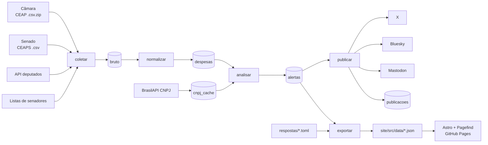
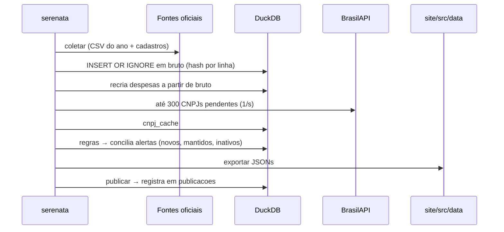
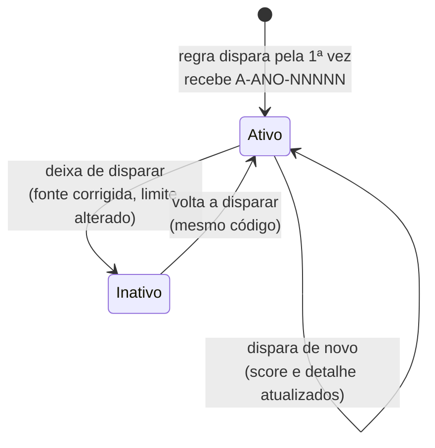
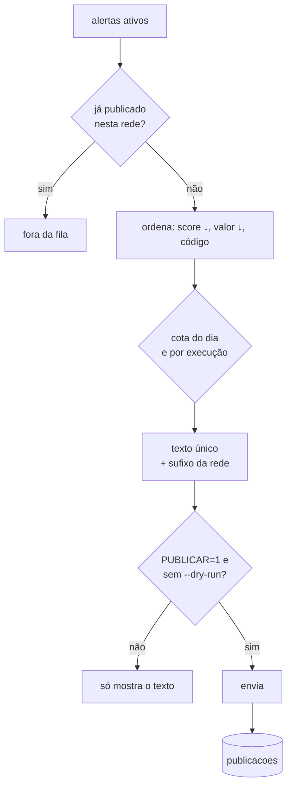

# Documentação do sistema

Este documento descreve como o Serenata funciona por dentro e como operá-lo. Para uma
visão geral, comece pelo [README](../README.md). Para as regras em detalhe, veja a
[metodologia](metodologia.md).

- [1. Visão geral](#1-visão-geral)
- [2. Componentes e pastas](#2-componentes-e-pastas)
- [3. Fluxo de dados](#3-fluxo-de-dados)
- [4. Modelo de dados (DuckDB)](#4-modelo-de-dados-duckdb)
- [5. Coleta e normalização](#5-coleta-e-normalização)
- [6. Análise e ciclo de vida dos alertas](#6-análise-e-ciclo-de-vida-dos-alertas)
- [7. Publicação nas redes](#7-publicação-nas-redes)
- [8. Site](#8-site)
- [9. Automação e estado persistente](#9-automação-e-estado-persistente)
- [10. Configuração](#10-configuração)
- [11. Operação (passo a passo)](#11-operação-passo-a-passo)
- [12. Testes](#12-testes)
- [13. Limitações conhecidas](#13-limitações-conhecidas)

## 1. Visão geral

O Serenata é um pipeline em Python com cinco etapas:

1. baixa as despesas oficiais da cota parlamentar da Câmara e do Senado;
2. converte tudo para um esquema único;
3. aplica regras determinísticas de atipicidade;
4. publica os alertas nas redes sociais;
5. exporta JSONs para um site estático (Astro) publicado no GitHub Pages.

O estado fica num arquivo DuckDB. No GitHub Actions, a parte do estado que não pode ser
recriada é salva num branch `data`.



## 2. Componentes e pastas

| Caminho | Papel |
|---|---|
| `pipeline/cli.py` | Comando `serenata` com os subcomandos `coletar`, `normalizar`, `analisar`, `exportar`, `publicar`, `resposta` e `estado`. |
| `pipeline/config.py` | Lê `config.toml` e os caminhos (`SERENATA_CONFIG`, `SERENATA_DB`). |
| `pipeline/http.py` | Cliente HTTP com User-Agent, timeout e retry com backoff exponencial. |
| `pipeline/db.py` | Esquema do DuckDB e funções de acesso (`consultar`, `escalar`, inserções). |
| `pipeline/coletores/` | `camara.py`, `senado.py` (fontes oficiais), `cnpj.py` (BrasilAPI) e `base.py` (hash e normalização de nomes). |
| `pipeline/normalizacao/` | Esquema `Despesa` (`esquema.py`) e conversão de cada casa (`normalizar.py`). |
| `pipeline/regras/` | Uma regra por arquivo (`r01` a `r05`), o contrato comum (`base.py`) e os feriados nacionais. |
| `pipeline/analise.py` | Aplica as regras e concilia a tabela `alertas` (códigos estáveis). |
| `pipeline/publicadores/` | Interface `Publicador`, modelo de texto único e as redes X, Bluesky e Mastodon. |
| `pipeline/publicacao.py` | Fila, limite diário, dry-run e log de publicações. |
| `pipeline/exportar.py` | Gera os JSONs consumidos pelo site. |
| `pipeline/respostas.py` | Direito de resposta: leitura e gravação de `respostas/*.toml`. |
| `pipeline/estado.py` | Salva e restaura o estado persistente em Parquet. |
| `site/` | Projeto Astro: páginas, componentes, estilos e `src/data/*.json`. |
| `tests/` | Testes (pytest), com fixtures reais pequenas em `tests/fixtures/`. |
| `.github/workflows/` | `ci.yml`, `pipeline.yml` e `publicar.yml`. |
| `.github/scripts/estado.sh` | Sincroniza a pasta `estado/` com o branch `data`. |
| `config.toml` | Fontes, limites das regras, pesos, limites de publicação e URL do site. |

## 3. Fluxo de dados



As etapas são independentes e podem ser rodadas de novo sem efeito colateral:

- `coletar` é idempotente, porque cada linha tem um hash.
- `normalizar` reconstrói a tabela `despesas` inteira.
- `analisar` concilia os alertas sem duplicar e sem reutilizar códigos.
- `exportar` sobrescreve os JSONs.

## 4. Modelo de dados (DuckDB)

Arquivo padrão: `data/serenata.duckdb`. O esquema é criado por `db.conectar`.

| Tabela | Chave | Conteúdo | Pode ser recriada? |
|---|---|---|---|
| `bruto` | `hash` | Cada linha das fontes, em JSON, com casa, ano e `coletado_em`. | Sim (baixando de novo) |
| `parlamentares` | `(casa, id)` | Cadastro: nome, nome normalizado, nome completo, partido, UF e foto. | Sim |
| `despesas` | `id` (= hash) | Esquema único `Despesa` (veja abaixo). | Sim (a partir de `bruto`) |
| `cnpj_cache` | `cnpj` | Situação cadastral, data da situação, início da atividade, razão social, erro e `consultado_em`. | Só consultando de novo (lento) |
| `alertas` | `codigo` | `regra_id`, `despesa_id`, score, detalhe, ativo, `criado_em` e `atualizado_em`. Único por `(regra_id, despesa_id)`. | **Não** (os códigos são públicos) |
| `publicacoes` | (log) | Rede, código, `publicado_em`, sucesso, id e URL externos, texto e erro. | **Não** (garante que nada se repita) |

**Esquema `Despesa`** (`pipeline/normalizacao/esquema.py`):

| Campo | Câmara | Senado |
|---|---|---|
| `id` | hash da linha | hash da linha |
| `casa` | `camara` | `senado` |
| `parlamentar_id` | `ideCadastro` | código oficial (ou `nome:<NOME>` sem vínculo) |
| `parlamentar_nome` | `txNomeParlamentar` | nome oficial do cadastro |
| `partido`, `uf` | da própria linha | do cadastro oficial |
| `data` | `datEmissao` (pode faltar) | `DATA` |
| `competencia` | `numAno`-`numMes` | `ANO`-`MES` |
| `categoria` | `txtDescricao` (grafia limpa) | `TIPO_DESPESA` |
| `fornecedor_nome`, `fornecedor_cnpj_cpf` | `txtFornecedor`, `txtCNPJCPF` (só dígitos) | `FORNECEDOR`, `CNPJ_CPF` |
| `valor` | `vlrLiquido` | `VALOR_REEMBOLSADO` (vírgula decimal) |
| `url_documento` | `urlDocumento` ou a página do deputado | página de transparência do senador |
| `fonte`, `coletado_em` | URL do arquivo e momento da coleta | idem |

## 5. Coleta e normalização

- **HTTP.** Toda requisição usa o User-Agent do projeto e um timeout. Erros de rede, 429 e
  5xx são repetidos com espera de `backoff_base × 2^n`. Erros 4xx falham na hora.
- **Câmara.** O ZIP traz um CSV com `;` em UTF-8 com BOM. O cadastro vem da API v2, com
  paginação, buscando as legislaturas que cobrem o ano.
- **Senado.** O CSV vem em Latin-1, e a primeira linha é metadado e é descartada. O
  vínculo ao cadastro passa por:
  1. a lista atual;
  2. as listas das legislaturas;
  3. um único candidato cujo nome completo contém todas as palavras do nome do CSV.
- **Hash.** É um SHA-256 de `casa + todos os campos + número da ocorrência`. Linhas
  idênticas no mesmo arquivo não se fundem.
- **Exclusões.** Linhas da Câmara sem `ideCadastro` (lideranças) não viram despesas.
- **Validação.** Todas as linhas passam pelo modelo pydantic antes de gravar. Se algo vier
  fora do padrão, a execução falha em vez de gravar dado errado.

## 6. Análise e ciclo de vida dos alertas

Cada regra (`pipeline/regras/rNN_*.py`) é uma função pura:

```python
def aplicar(despesas: pl.DataFrame, params: dict, contexto: Contexto) -> pl.DataFrame:
    # devolve: despesa_id, intensidade (0 a 1), detalhe (texto factual)
```

`score = round(100 × peso × intensidade)`. O peso vem de `config.toml`.



- O código usa o ano da **competência** da despesa e uma sequência por ano, em ordem
  cronológica. Um código **nunca** é reutilizado.
- Alertas inativos saem do site e da fila de publicação, mas continuam no banco.
- R04 só avalia CNPJs que já estão em `cnpj_cache`. A cada `analisar`, até
  `max_consultas_por_execucao` CNPJs são consultados, começando pelos que mais receberam.

## 7. Publicação nas redes



- **Texto.** Há um modelo único para todos (`publicadores/base.py:texto_base`).
  Categoria e fornecedor longos são encurtados com "…" até o texto caber.
- **X.** API v2 `POST /2/tweets`, com OAuth 1.0a assinado em `x.py`. **Não leva link.**
  O limite de 280 caracteres usa a contagem ponderada do X.
- **Bluesky.** Usa `atproto`, com link clicável (facet) e card. Limite de 300.
- **Mastodon.** Usa `Mastodon.py`, com o aviso completo e o link. Limite de 500, e cada
  URL conta como 23 caracteres.
- **Controle.** O limite diário é contado desde a meia-noite de Brasília. Falhas ficam
  registradas e o alerta volta para a fila na próxima execução. Uma rede sem credenciais é
  ignorada na publicação real.

## 8. Site

O site é feito em Astro e gerado a partir de `site/src/data/*.json`:

| Arquivo | Conteúdo |
|---|---|
| `meta.json` | Nome e URL do site, momento da atualização, aviso, totais, alertas de hoje e contagem por regra. |
| `alertas.json` | Alertas ativos com todos os campos da despesa e as respostas. |
| `parlamentares.json` | Totais por categoria e por mês e códigos dos alertas de cada parlamentar. |
| `fornecedores.json` | Fornecedores que aparecem em alertas, com os totais recebidos. |
| `regras.json` | Id, nome, descrição, parâmetros e código-fonte de cada regra. |
| `respostas.json` | Respostas recebidas. |

| Rota | Página |
|---|---|
| `/` | Capa: manchete (o alerta de maior score do lote mais recente), números do dia e mais alertas |
| `/alertas/`, `/alertas/N/` | Lista paginada (30 por página) |
| `/alerta/<código>/` | Ficha completa, regra, link oficial e direito de resposta (+ `.json` e `.csv`) |
| `/parlamentar/<casa>-<id>/` | Gráficos por mês e por categoria e alertas (+ `.json` e `.csv`) |
| `/fornecedor/<cnpj ou hash>/` | Totais e alertas (+ `.json` e `.csv`) |
| `/busca/` | Pagefind: código, nome e CNPJ, com filtros por casa, UF, partido, regra e tipo |
| `/metodologia/`, `/direito-de-resposta/`, `/sobre/`, `/dados/` | Páginas institucionais e downloads |
| `/rss.xml`, `/atom.xml` | Os 50 alertas mais recentes |

O site é servido sob um subcaminho (`/serenata`). Por isso todo link passa por `url()` em
`src/lib/dados.ts`. Nas páginas de fornecedor, o CPF de pessoa física aparece parcialmente
oculto e nunca entra na URL.

## 9. Automação e estado persistente

| Workflow | Quando roda | O que faz |
|---|---|---|
| `ci.yml` | Em todo push e PR | Ruff, pytest e build do site. |
| `pipeline.yml` | Diariamente às 09:00 UTC (06:00 em Brasília), manualmente, ou em push que altere `pipeline/`, `config.toml`, `respostas/` ou `site/` | Restaura o estado, coleta, analisa, exporta, salva o estado, faz commit dos JSONs e faz build e deploy no Pages. |
| `publicar.yml` | Dias úteis às 12, 15, 18 e 21 UTC, ou manualmente (dry-run por padrão) | Coleta (para ter as despesas), restaura o estado, publica e salva o log. |

**Branch `data`.** Guarda `alertas.parquet`, `publicacoes.parquet` e
`cnpj_cache.parquet`. Cada execução faz um commit nele, que funciona como trilha de
auditoria. Os dois workflows que escrevem no estado usam o grupo de concorrência
`serenata-estado`, para nunca rodarem ao mesmo tempo.

## 10. Configuração

Arquivo `config.toml`:

| Seção | Chaves |
|---|---|
| `[coleta]` | `user_agent`, `timeout_segundos`, `tentativas`, `backoff_base_segundos`, e `[coleta.urls]` |
| `[cnpj]` | `url`, `intervalo_segundos`, `max_consultas_por_execucao`, `validade_dias` |
| `[regras.<id>]` | `peso` e os parâmetros de cada regra (limite, categorias, percentil…) |
| `[site]` | `nome`, `url` (usada nos links dos posts) |
| `[publicacao]` | `fuso`, `por_execucao`, `[publicacao.limite_diario]` por rede |

Variáveis de ambiente: `SERENATA_DB`, `SERENATA_CONFIG`, `PUBLICAR` e as credenciais das
redes (veja `.env.example`). Para o build do site: `SITE_URL` e `BASE_PATH`.

## 11. Operação (passo a passo)

**Rodar tudo localmente e ver o site**

```bash
uv run serenata coletar --ano 2026
uv run serenata analisar          # use --sem-cnpj para pular a BrasilAPI
uv run serenata exportar
cd site && npm ci && npm run build && npm run preview
# abra http://localhost:4321/serenata/
```

**Ver os posts sem publicar**

```bash
uv run serenata publicar --dry-run
uv run serenata publicar --dry-run --rede x --limite 5
```

**Registrar uma resposta recebida**

```bash
uv run serenata resposta --alerta A-2026-00123 --autor "Gabinete do Dep. Fulano" --arquivo resposta.txt
git add respostas/ && git commit -m "docs(respostas): registra resposta ao alerta A-2026-00123"
```

O push dispara o `pipeline.yml`, e a resposta aparece no site.

**Mudar um limite.** Edite `config.toml`, rode `uv run pytest` e faça o commit. Na
próxima análise, os alertas que deixarem de disparar ficam inativos e os novos recebem
códigos novos.

**Adicionar uma regra**

1. Crie `pipeline/regras/r06_nome.py` com `aplicar` e `REGRA`.
2. Registre a regra em `pipeline/regras/__init__.py`.
3. Adicione `[regras.R06_nome]` com `peso` em `config.toml`.
4. Crie `tests/regras/test_r06_nome.py`.

O teste de imparcialidade em `tests/test_analise.py` passa a cobrir a nova regra
automaticamente.

**Ligar a publicação real.** No GitHub, cadastre os secrets e defina a variável de
repositório `PUBLICAR=1`. Para desligar, apague a variável ou mude o valor.

**Recuperar o estado local a partir do branch `data`**

```bash
bash .github/scripts/estado.sh baixar
uv run serenata estado restaurar
```

## 12. Testes

`uv run pytest` roda sem rede, em poucos segundos:

| Arquivo | Cobre |
|---|---|
| `tests/test_http.py` | Retry, backoff e User-Agent |
| `tests/test_coletores.py` | Leitura dos CSVs reais (fixtures), paginação, vínculo de senadores e idempotência |
| `tests/test_normalizacao.py` | Esquema único, campos de cada casa e reprodutibilidade |
| `tests/regras/test_r0*.py` | Uma suíte por regra |
| `tests/test_analise.py` | Score, códigos estáveis, alertas inativos, cache de CNPJ e **imparcialidade** |
| `tests/test_publicadores.py` | Modelo de texto, limites, linguagem neutra, OAuth (exemplo oficial), fila, dry-run, limite diário e falhas |
| `tests/test_exportar.py` | JSONs do site e direito de resposta |
| `tests/test_estado.py` | Salvar e restaurar o estado |

## 13. Limitações conhecidas

- **Alimentação no Senado.** O Senado não separa alimentação de locomoção e hospedagem,
  por isso a R01 só se aplica à Câmara.
- **Despesas sem data.** Cerca de 2% das despesas da Câmara vêm sem data de emissão. As
  regras que dependem da data (R02, R04 e R05) não as avaliam.
- **Partido dos senadores.** O partido de senadores fora do exercício atual pode vir
  vazio, porque a lista da legislatura não traz partido.
- **Link do Senado.** O CSV não traz link por documento, então o link oficial é a página
  de transparência do senador no ano.
- **Cobertura da R04.** Com 300 consultas por execução, cobrir os cerca de 22 mil CNPJs de
  um ano leva semanas. Os de maior valor vêm primeiro.
- **R02 e o fornecedor.** A R02 compara pelo CNPJ/CPF; quando ele falta, compara pelo nome
  em maiúsculas.
